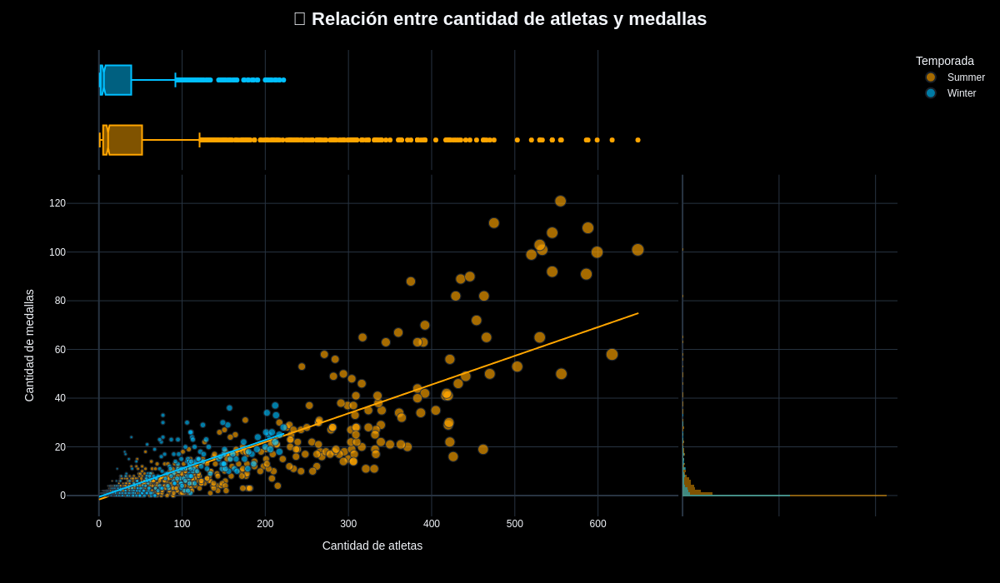

🏅 Análisis Exploratorio de Datos — Juegos Olímpicos

📌 Descripción del proyecto

Proyecto académico desarrollado para la materia Práctica Profesionalizante I, correspondiente a la Tecnicatura en Ciencia de Datos e Inteligencia Artificial.

El objetivo es realizar un Análisis Exploratorio de Datos (EDA) sobre la participación y el rendimiento de los países en los Juegos Olímpicos, utilizando herramientas de análisis, procesamiento y visualización de datos.

El dataset original contiene más de 315.000 registros históricos. Para el análisis se seleccionaron las ediciones comprendidas entre 1992 y 2026.

🛠️ Tecnologías utilizadas

Python

Pandas y NumPy

Plotly

Estadística descriptiva y análisis de correlación

🔎 Metodología

El trabajo comprende las siguientes etapas:

Exploración inicial del dataset.

Identificación y tratamiento de valores faltantes.

Filtrado y preparación de los datos.

Análisis exploratorio y estadístico.

Elaboración de visualizaciones interactivas.

Evaluación de hipótesis e interpretación de resultados.

📊 Hipótesis analizadas

H1 — Participación y medallas

Se investigó la relación entre la cantidad de atletas participantes y las medallas obtenidas por los países.

Resultado: Se observó una correlación positiva fuerte, aproximadamente de 0,88, entre ambas variables.

### Visualización de la hipótesis 1

H2 — Eficiencia de las delegaciones

Se analizó si los países con mayor cantidad de medallas son necesariamente los que presentan mayor eficiencia, medida mediante la relación entre medallas obtenidas y atletas participantes.

Resultado: Las delegaciones grandes presentaron, en general, mayor eficiencia. Las delegaciones pequeñas mostraron mayor sensibilidad a las variaciones debido al menor número de participantes.

H3 — Ventaja de la localía

Se evaluó si los países anfitriones obtienen, en promedio, más medallas cuando organizan los Juegos Olímpicos.

Resultado: Los países analizados obtuvieron un promedio aproximado de 36,89 medallas como anfitriones, frente a 20,65 cuando no fueron locales.

📈 Visualizaciones

El notebook contiene gráficos interactivos desarrollados con Plotly, que permiten explorar las relaciones entre participación, medallas, eficiencia y localía.

📂 Fuente de datos

Dataset olímpico disponible en:

https://github.com/ismayc/olympic-moderndive-data

🎯 Conclusión general

El análisis permitió identificar relaciones entre el tamaño de las delegaciones, el rendimiento deportivo y la condición de país anfitrión.

El proyecto demuestra la aplicación de herramientas de procesamiento, análisis estadístico y visualización para transformar datos en información interpretable.

👨‍💻 Autoría

Matías Carrillo y Gustavo Portal

Proyecto académico — Tecnicatura en Ciencia de Datos e Inteligencia Artificial.
